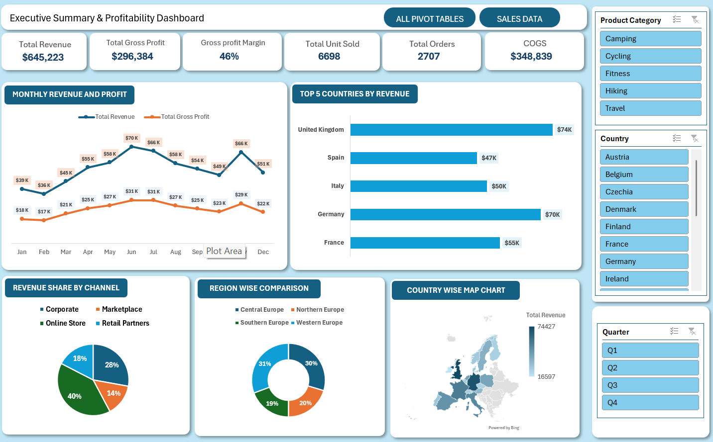

# Excel Sales Dashboard

An executive summary and profitability dashboard built in Microsoft Excel. It turns a year of raw sales records into a one-page view of revenue, profit and costs that you can filter by product category, country and quarter.

## Headline figures

| Metric | Result |
|---|---:|
| Total revenue | $645,223 |
| Gross profit | $296,384 |
| Gross profit margin | 46% |
| Cost of goods sold | $348,839 |
| Total orders | 2,707 |
| Units sold | 6,698 |

## What the dashboard shows

- **KPI cards** for revenue, gross profit, margin, units, orders and COGS.
- **Monthly revenue and profit**, as a line chart across the year.
- **Top five countries by revenue.**
- **Revenue share by sales channel**: corporate, marketplace, online store and retail partners.
- **Regional comparison** across Central, Northern, Southern and Western Europe.
- **A map of revenue by country.**
- **Slicers** for product category, country and quarter. Every chart and KPI updates when you change them.

Buttons at the top jump to the pivot tables and to the raw sales data.

## Built with

Microsoft Excel: pivot tables, pivot charts, slicers and a map chart.

## How to open it

Download `Excel Sales Dashboard_3.xlsx` and open it in Excel for Windows or Mac (Microsoft 365 or Excel 2019 and later). The map chart needs an internet connection to draw. Excel on the web can show the dashboard, but some slicer interactions are limited there.

## What I learned

This project helped me practise profitability analysis and interactive reporting, and turning raw numbers into something a manager can read at a glance. Next, I'm working with SQL, Power BI, Python and Tableau.

---

**Author:** Abia Iqbal
